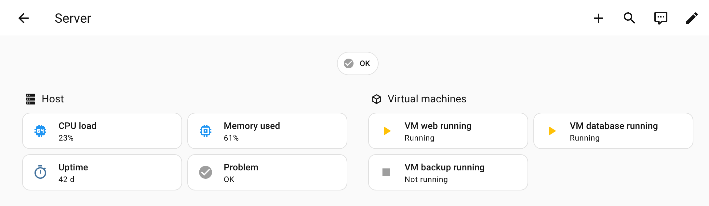
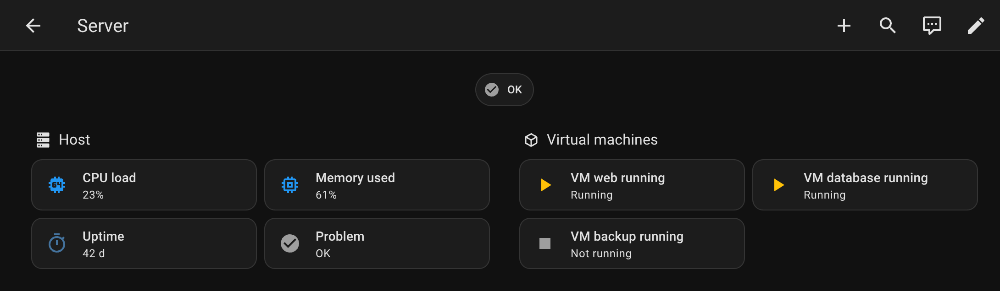
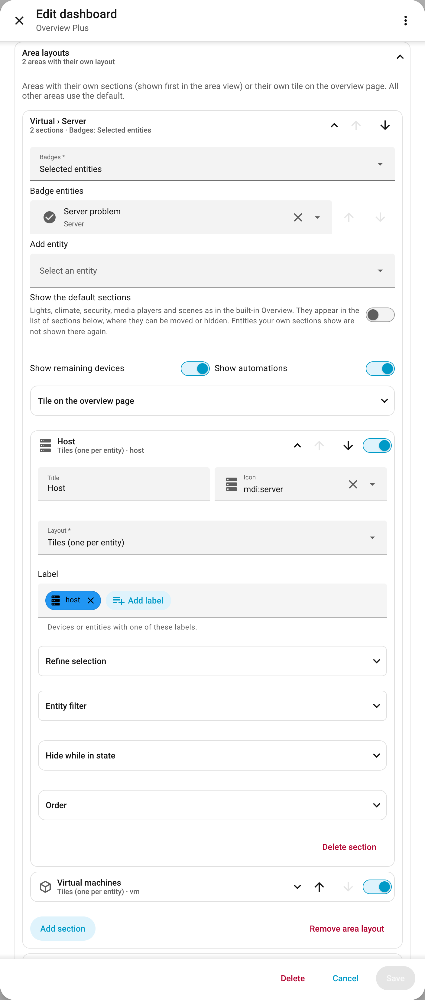
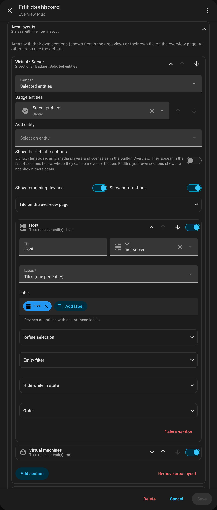
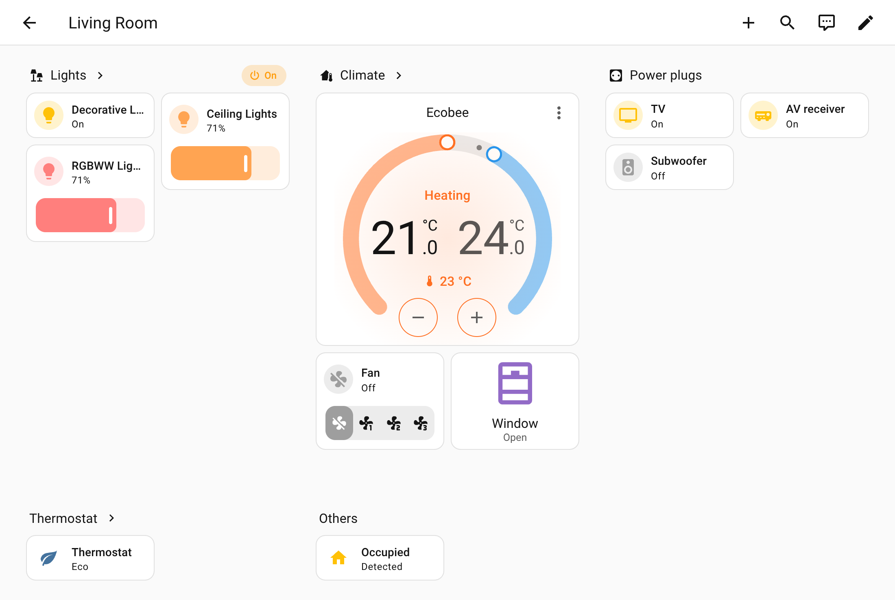
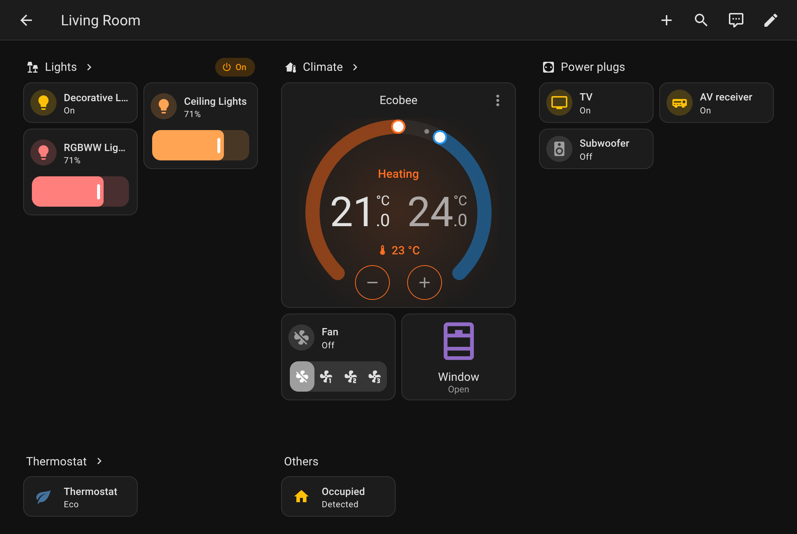
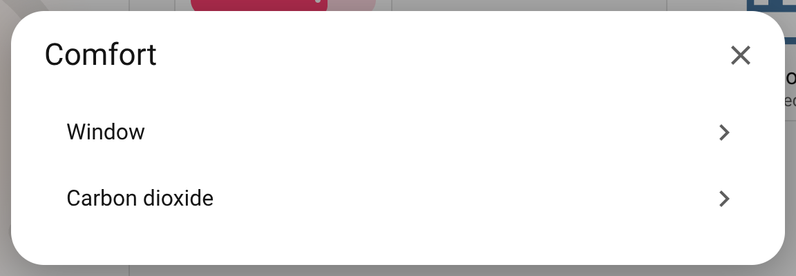
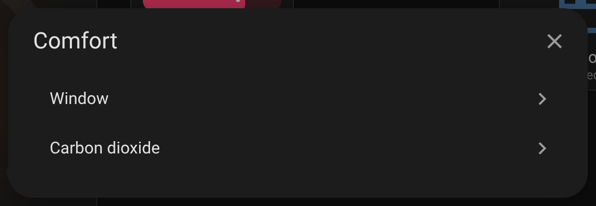
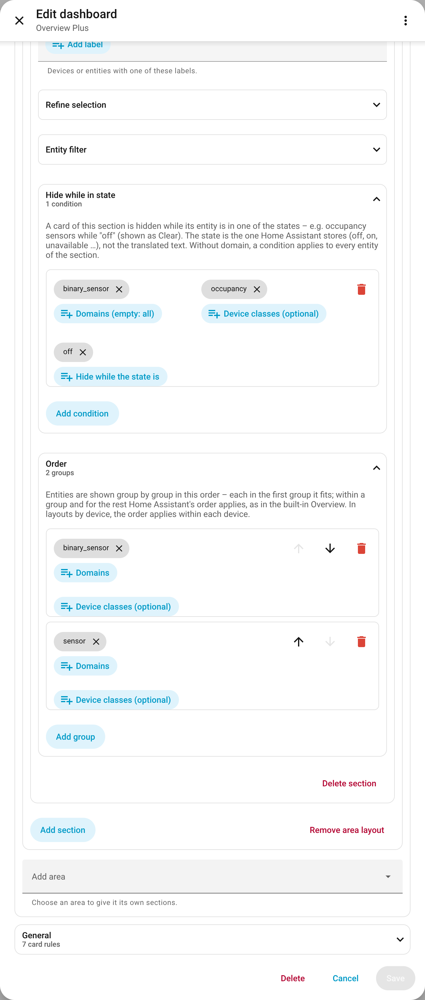
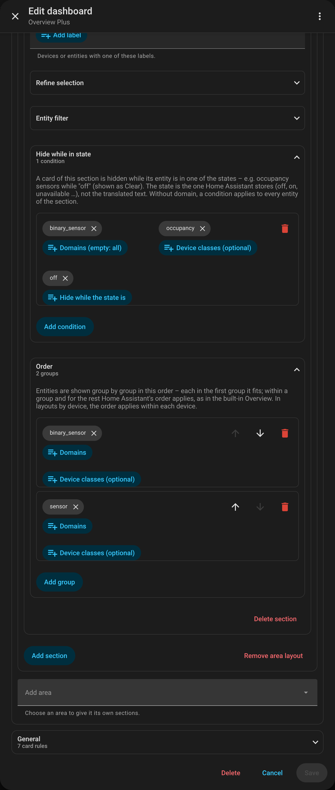

# Area layouts

[← Back to the overview](../README.md)

Every area has a view, by default with the same structure as in the built-in Overview. An area can get
its own layout: its own sections, badges and tile on the overview page. In the editor: *Area layouts →
Add area*; *Remove area layout* returns it to the default view.

**Example:** *Host* and *Virtual machines* are selected by label, and the area name is removed from the
card names ("Server CPU load" → "CPU load"). [Card rules](card-rules.md) set the CPU and memory icons.

<table>
<tr>
<td width="50%"></td>
<td width="50%"></td>
</tr>
</table>

```yaml
strategy:
  type: custom:overview-plus
  area_overrides:
    server:                          # area id
      badges: [binary_sensor.server_problem]   # false = none; default: area temperature/humidity
      sections:
        - title: Host
          icon: mdi:server
          match: { label: host }
        - title: Virtual machines
          icon: mdi:cube-outline
          match: { label: vm }
      show_default_sections: false   # default
      show_other_devices: true       # default
      show_automations: true         # default
```

The configured sections are shown in order, followed by all remaining devices of the area and its
automations, as in the default view. `match` selects entities with the
[match syntax](reference.md#match-specifications).

<details>
<summary>Screenshot: an area layout in the editor</summary>

<table>
<tr>
<td width="50%"></td>
<td width="50%"></td>
</tr>
</table>

</details>

## With the default sections

The standard categories (lights, climate, security, media players, scenes) are left out – unless
`show_default_sections: true` is set. This way an area like *Server* shows only its own sections,
while a *Living room* keeps the default view and gains e.g. a section with all its power plugs:

<table>
<tr>
<td width="50%"></td>
<td width="50%"></td>
</tr>
</table>

```yaml
      show_default_sections: true
      sections:
        - default: light               # light, climate, security, media_players, scenes
        - default: climate
        - title: Power plugs
          icon: mdi:power-socket-eu
          match: { label: power_plug }
```

- Standard categories the list does not name come first. Without
  `show_default_sections` the `default` entries are ignored (the editor removes them when the option is
  switched off).
- Any section, own or default, can be hidden with `hidden: true` (e.g. `- { default: scenes, hidden: true }`).
  A hidden section shows nothing and selects nothing: its entities appear with the remaining devices.
- An **entity** is shown only once, in the first section that selects it (`match` and `entities`).
  The configured sections select first, the standard categories take what is left. Other entities of
  the same device are not taken along: they can be selected by a later section, or appear in the
  device's card below, as in the built-in area view.

## Section heading

The heading of a section opens the device page if the section shows entities of one device, or a list
of its devices if it shows several – a click on a device opens its device page. Device pages are for
administrators; for other users the heading has no action.

<table>
<tr>
<td width="50%"></td>
<td width="50%"></td>
</tr>
</table>

## Layouts

- `tiles` (default): one tile per entity.
- `devices`: a heading per device with its entities.
- `compact`: one tile per device showing its primary entity, named after the device, opening the
  device page. The primary entity is chosen by `primary` ([match spec](reference.md#match-specifications))
  or automatically (running/connectivity/power sensor, switch, binary sensor, sensor), e.g.
  `primary: { domain: binary_sensor, device_class: running }`.
- `table`: one entities card per device.

## Which entities

`entities` narrows which matched entities are shown: `include_domains`, `exclude_domains`,
`include_categories` (default `[none, diagnostic]`, i.e. configuration entities are hidden),
`exclude_device_classes`, `exclude` (entity ids).

### Hide while in state

`entities.hide_states` hides a card **while** its entity is in one of the states (live, no reload); a
heading with nothing left to show disappears too. `domain` and `device_class` are optional (one value
or a list); a plain list of states applies to every entity of the section:

```yaml
          entities:
            hide_states:
              - { domain: binary_sensor, device_class: occupancy, states: [off] }   # "Clear"
              - { domain: media_player, states: [off, standby] }
```

The states are the ones Home Assistant stores (`off`), not the translated text (*Clear*).

## Order

`sort` orders the entities of a section group by group – each in the first group it fits, the rest after
them; without `sort`, and within a group, Home Assistant's order applies as in the built-in Overview. A
group has a `domain`, a `device_class` or both (one value or a list); a plain string is a domain. In
the `devices` and `table` layouts, devices keep their order and `sort` applies within each device;
`compact` ignores it:

```yaml
          sort:
            - { domain: binary_sensor, device_class: occupancy }
            - { domain: [switch, light] }
```

<details>
<summary>Screenshot: hide while in state and order in the editor</summary>

<table>
<tr>
<td width="50%"></td>
<td width="50%"></td>
</tr>
</table>

</details>

## Tile on the overview page

`tile` options are merged into the area card on the overview page; any option of the area card can be
used. An area can have a `tile` without `sections` – its area view then stays the default.

```yaml
      tile:
        sensor_classes: []           # default: [temperature] if the area has a temperature sensor
        alert_classes: [problem]
        color: blue
```

The area card can only show values combined by device class (e.g. the median temperature of the area).
To show specific entities instead – also diagnostic sensors and sensors without device class – list them
under `tile.entities`; the tile then uses Overview Plus' own area tile, which looks like the compact area
card:

```yaml
      tile:
        entities: [sensor.server_cpu_load, sensor.server_memory_used]   # shown in this order: "23% · 61%"
        show_names: true                                 # with the entity names
        alert_entities: [binary_sensor.server_problem]   # badge while one of them is on
        alert_classes: [problem]
```
