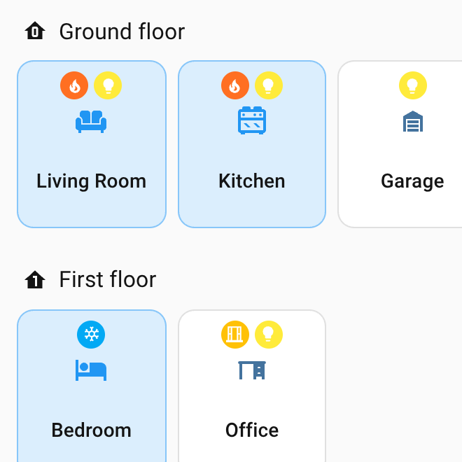
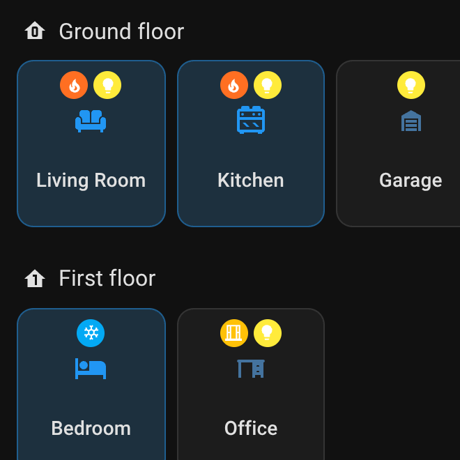

# Area states

[← Back to the overview](../README.md)

The area tiles on the overview page can show what is going on in a room: a **tinted tile** (e.g.
occupied) and **colored chips** above the area icon (e.g. heating, lights on, window open).

<table>
<tr>
<td width="50%"></td>
<td width="50%"></td>
</tr>
</table>

| State | Active while | Default |
|---|---|---|
| Occupied | an occupancy or presence sensor is on | tinted tile, blue |
| Problem | a problem, leak, smoke, gas, CO or safety sensor is on | chip, red |
| Heating / Cooling | a thermostat is heating / cooling | chip, deep orange / light blue |
| Humidifying / Dehumidifying | a humidifier is humidifying / drying | chip, teal / brown |
| Window or door open | a window, door, opening or garage door sensor is on | chip, amber |
| Unlocked | a lock is unlocked or open | chip, orange |
| Lights on | a light is on | chip, yellow |
| Media playing | a media player is playing (icon: TV, speaker …) | chip, purple |
| Fan on / Vacuum cleaning | a fan is on / a vacuum is cleaning | chip, cyan / green |

- States are detected from the entities of each area (also through their device): a state is active
  if **any** matching entity is. Motion sensors do not count as occupancy – give an aggregated
  template sensor the device class *occupancy*.
- The order of the states is their importance: the first active tinted state tints the tile, the chips
  follow the order. Up to four chips are shown; with more, three chips and a `+N` chip (hover it for
  the rest).
- **Own states** watch any entity, e.g. a washing machine that is running.
- With area states, the areas use Overview Plus' own area tile (it looks like the compact area card and
  shows the same temperature). An area whose tile is set to `display_type: picture` / `camera` or has
  `features` keeps the area card – without area states.

Set up in the editor: [Area states](editor.md#area-states).
