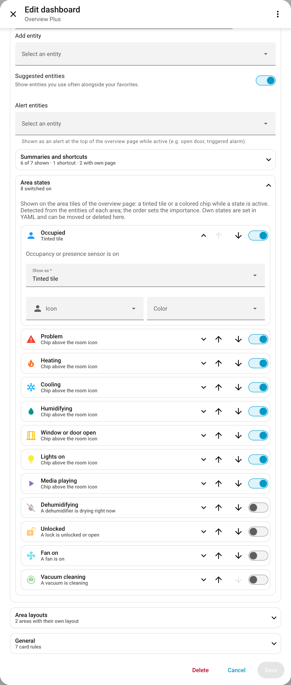
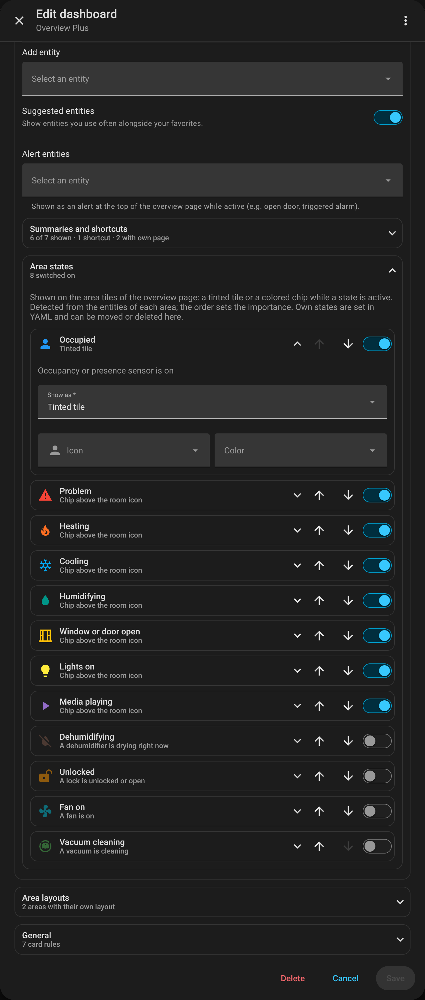

# Area states

[← Back to the overview](../README.md)

The area tiles on the overview page can show what is going on in a room: a **tinted tile** (e.g.
occupied) and **colored chips** above the room icon (e.g. heating, lights on, window open).

<table>
<tr>
<td width="50%"></td>
<td width="50%"></td>
</tr>
</table>

In the editor: *Overview page → Area states* – switch states on, order them by importance, choose
tinted tile or chip, icon and color.

```yaml
strategy:
  type: custom:overview-plus
  area_indicators:                     # order = importance
    - preset: occupied                 # tinted tile
    - preset: heating                  # chip
    - preset: humidifying
    - preset: window_open
      color: red                       # override icon, color or style (tile | icon)
```

| Preset | Active while | Default |
|---|---|---|
| `occupied` | an occupancy or presence sensor is on | tinted tile, blue |
| `problem` | a problem, leak, smoke, gas, CO or safety sensor is on | chip, red |
| `heating` / `cooling` | a thermostat is heating / cooling (`hvac_action`) | chip, deep orange / light blue |
| `humidifying` / `drying` | a humidifier is humidifying / drying (`action`) | chip, teal / brown |
| `window_open` | a window, door, opening or garage door sensor is on | chip, amber |
| `unlocked` | a lock is unlocked or open | chip, orange |
| `lights_on` | a light is on | chip, yellow |
| `media_playing` | a media player is playing (icon: TV, speaker …) | chip, purple |
| `fan_on` / `cleaning` | a fan is on / a vacuum is cleaning | chip, cyan / green |

- States are detected from the entities of each area (also through their device): a state is active
  if **any** matching entity is. Motion sensors do not count as occupancy – give an aggregated
  template sensor `device_class: occupancy`, or set it with `entity:`.
- `entity:` (one or a list) uses only these entities instead of searching the area.
- The first active tile state tints the tile. Up to four chips are shown; with more states, three
  chips and a `+N` chip (hover it for the rest).
- With area states, the areas use Overview Plus' own area tile (it looks like the compact area card
  and shows the same temperature). An area whose tile is set to `display_type: picture` / `camera` or
  has `features` keeps the area card – without area states.

<details>
<summary>Screenshot: area states in the editor</summary>

<table>
<tr>
<td width="50%"></td>
<td width="50%"></td>
</tr>
</table>

</details>

## Own states

`{ name, entity, state, icon, color, style }`, e.g. a washing machine that is `running`:

```yaml
  area_indicators:
    - name: Washing
      entity: sensor.washing_machine
      state: running
      icon: mdi:washing-machine
      color: blue
```

- Shown as a chip unless `style: tile`.
- `state` is `on` if not set (also several: `state: [heat, boost]`); `attribute:` compares an
  attribute instead of the state.
- Instead of `entity:`, `domain:` (and `device_classes:`) searches the area like a preset.
- Own states are set in YAML; the editor lists them so they can be moved or deleted.
