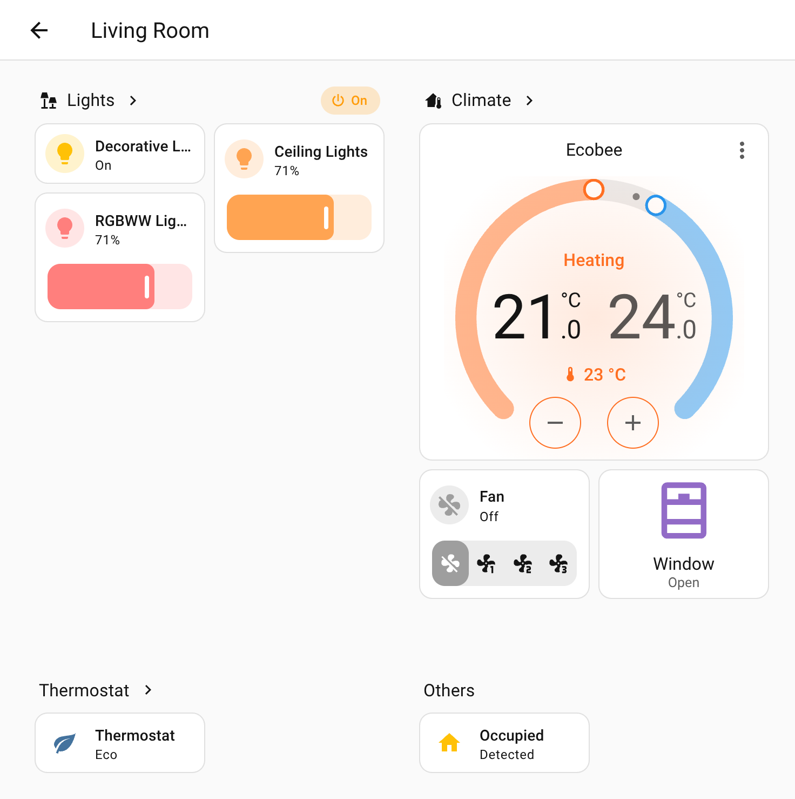
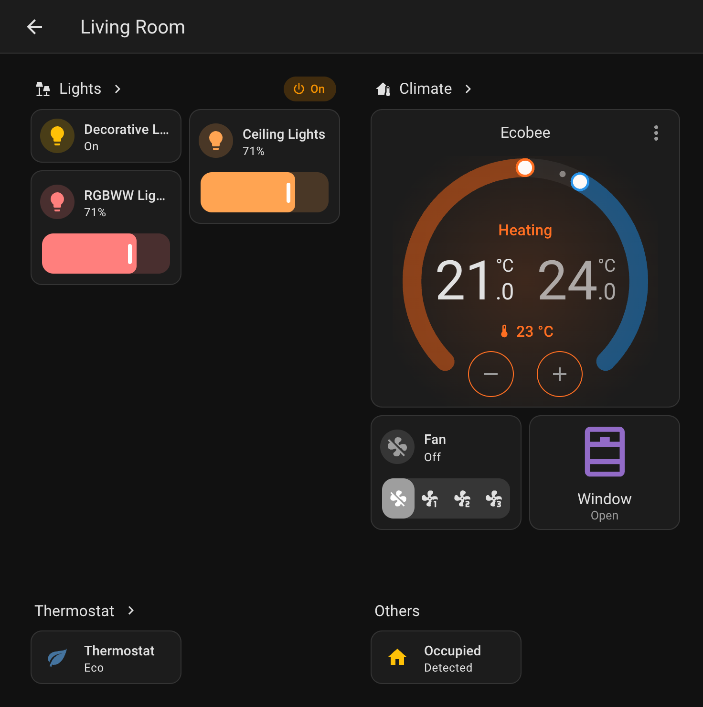
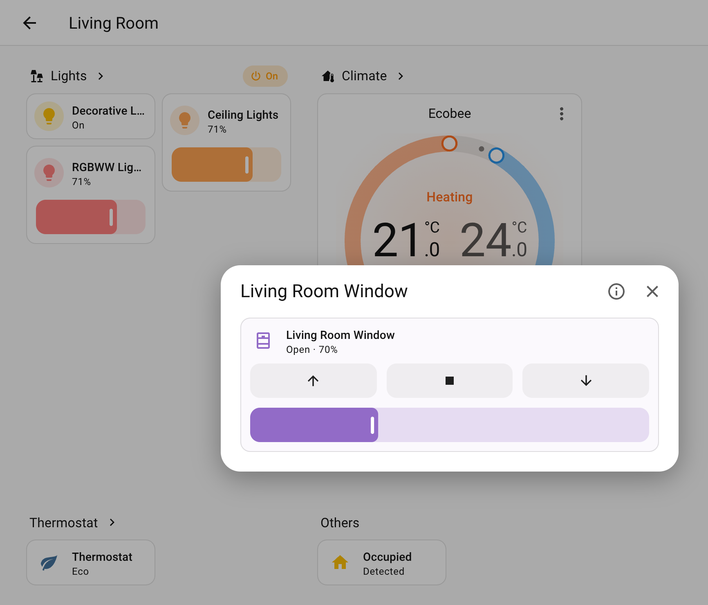
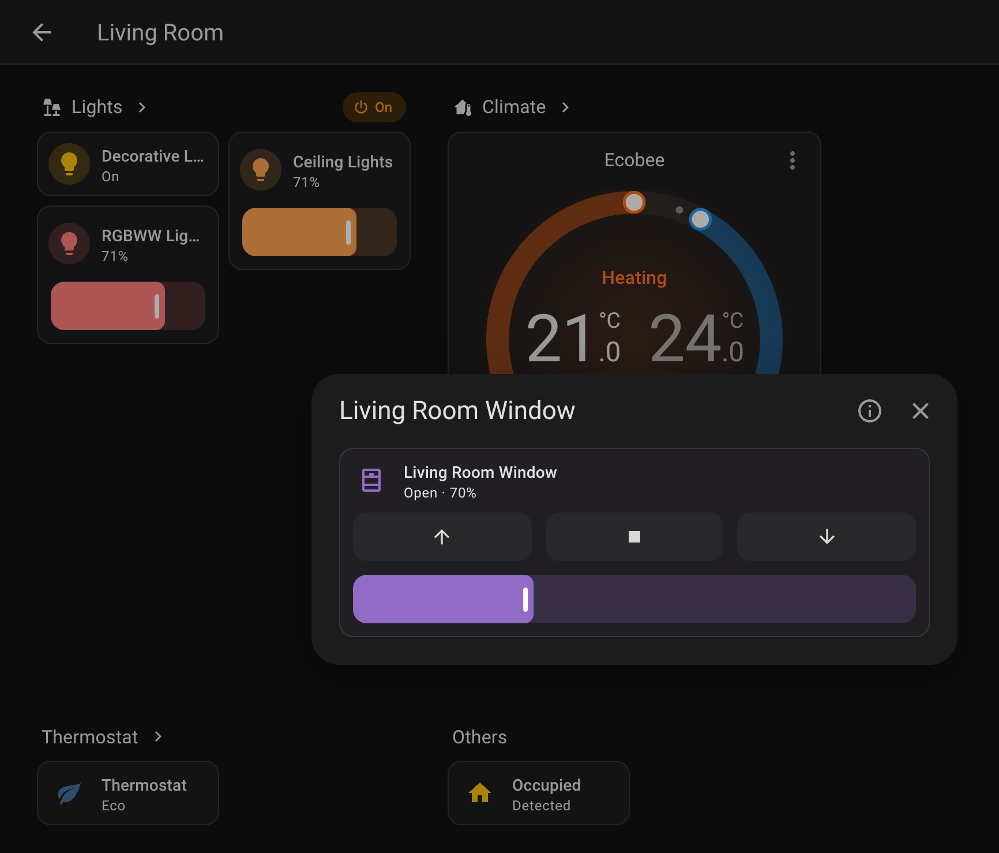

# Card rules

[← Back to the overview](../README.md)

Card rules replace, adjust or hide the cards of selected entities or devices – in the favorites on the
overview page, the area views, the media players view and the devices view. **Example:** in the default area view a rule
replaces the climate tile with a thermostat card.

<table>
<tr>
<td width="50%"></td>
<td width="50%"></td>
</tr>
</table>

```yaml
strategy:
  type: custom:overview-plus
  card_rules:
    # Replace the card of all Better Thermostat entities …
    - match: { integration: better_thermostat, domain: climate }
      card:
        type: custom:better-thermostat-normal-climate-card
    # … and adjust it for one of them (no `type` = merged into the current card)
    - match: { entity: climate.bathroom }
      card: { name: Bathroom }
    # Cameras as picture cards, only in the highlighted area sections
    - match: { domain: camera }
      contexts: [area]
      card: { type: picture-entity, show_state: false }
    # Hide entities with a label
    - match: { label: dashboard-hidden }
      card: false
    # One card per device instead of one tile per entity
    - match: { label: virt-guest }
      scope: device
      card:
        type: entities
        title: $device
        entities: $entities
```

- `match` selects entities with the [match syntax](reference.md#match-specifications).
- Rules are evaluated in order and **all** matching rules apply. A `card` with a different `type`
  replaces the card, a `card` without `type` is merged into it, `card: false` hides the entity.
  `stop: true` ends the evaluation for that entity.
- `entity` is set automatically unless the card uses the `$entity` placeholder. A rule with `tap`
  may leave out `card`. Placeholders: `$entity`, `$device`, `$area`, and `$entities` (device scope,
  list of entity ids).
- `contexts` limits where a rule applies: `favorites` (favorites and suggested entities on the
  overview page), `area` (highlighted sections of an area view), `area_other` (remaining devices of
  an area view), `media` (media players view), `devices` (devices view). In the devices view every
  device is one entities card: device rules replace it, entity rules can only hide rows.
- `scope: device` turns all entities of a matching device into one card (first matching rule wins).

In the editor: *General → Card rules*. Only the options specific to a replacement card are YAML there
(*More card options*), because every card type has different ones.

## Popup on tap

A rule can show a card of your choice in a popup instead of the entity's info dialog (*On tap → Card in
a popup* in the editor). This works with any card that opens the info dialog when tapped – tiles,
buttons, most custom cards – and also for rules that do not replace the card. Here a button card opens a
tile with cover controls:

<table>
<tr>
<td width="50%"></td>
<td width="50%"></td>
</tr>
</table>

```yaml
  card_rules:
    # Small card in favorites and area views, the full card when tapped
    - match: { integration: better_thermostat, domain: climate }
      contexts: [favorites, area]
      card: { type: custom:my-mini-thermostat-card }
      tap:
        popup: { type: custom:better-thermostat-ui-card }
    # Keep the default tile, but show cover controls when tapped
    - match: { domain: cover }
      tap:
        popup:
          type: tile
          features: [{ type: cover-open-close }, { type: cover-position }]
```

- `entity` of the popup card is set to the tapped entity; use `$entity` to place it yourself
  (e.g. `entities: [$entity, sensor.x]`). `$device`, `$area` and `$entities` work as in `card`.
- The popup has a button for the regular info dialog. On phones it fills the screen.
- The popup of the last matching rule applies; `tap: false` removes it again.

<details>
<summary>Screenshot: a card rule with a popup in the editor</summary>

<table>
<tr>
<td width="50%"></td>
<td width="50%"></td>
</tr>
</table>

</details>
