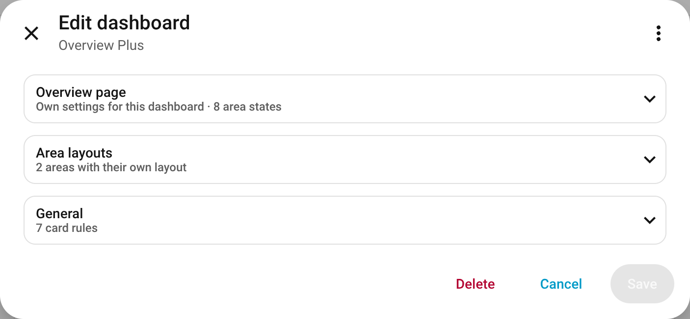
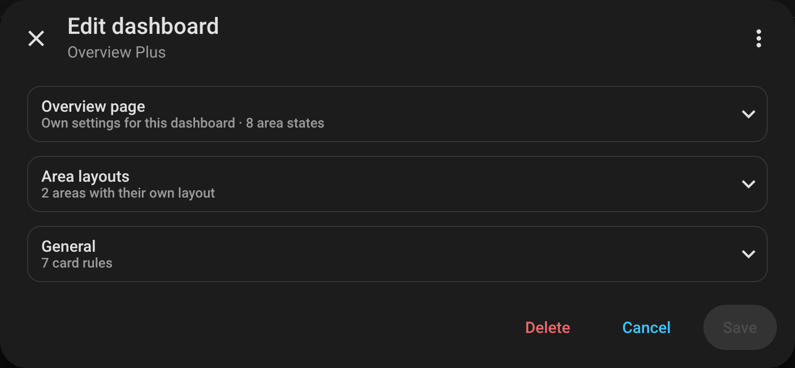
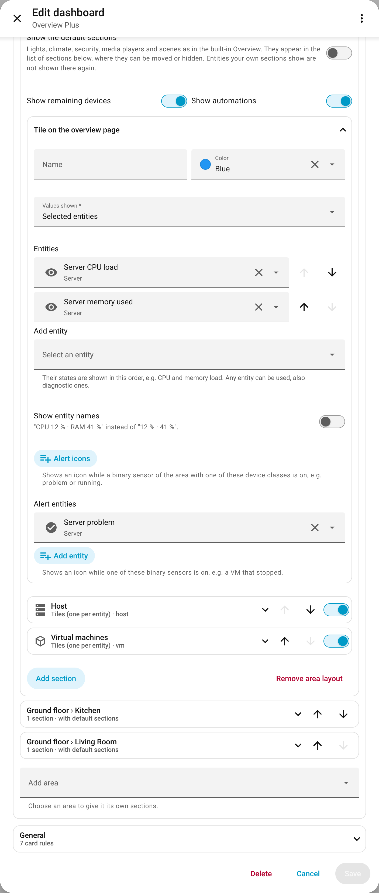
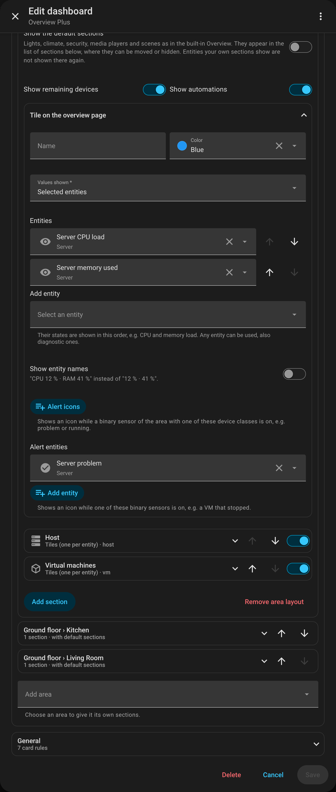
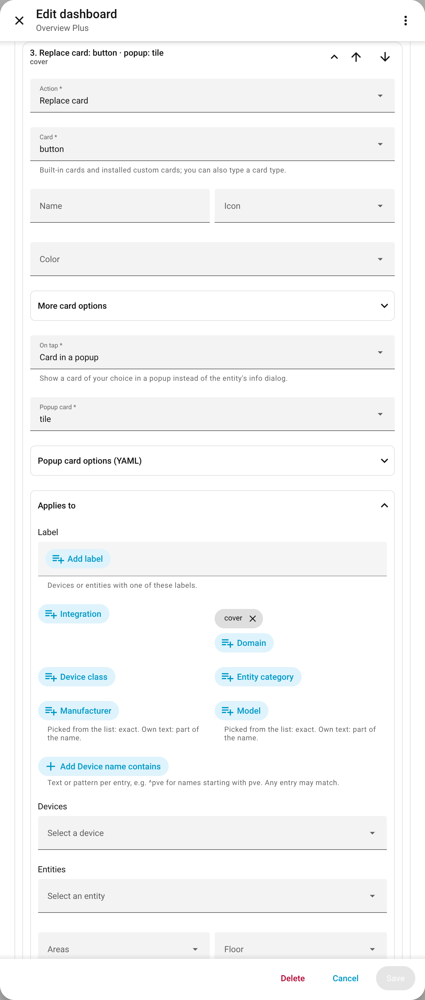
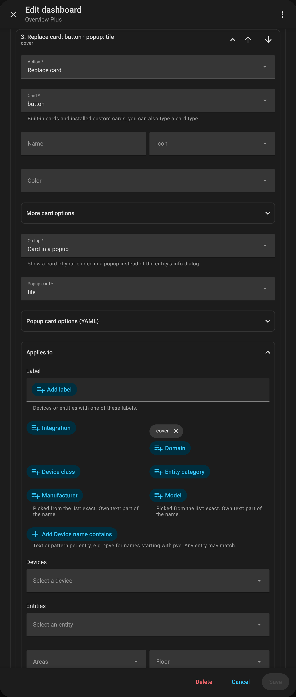
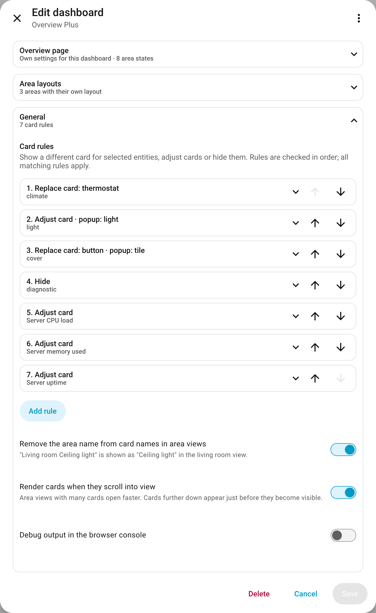
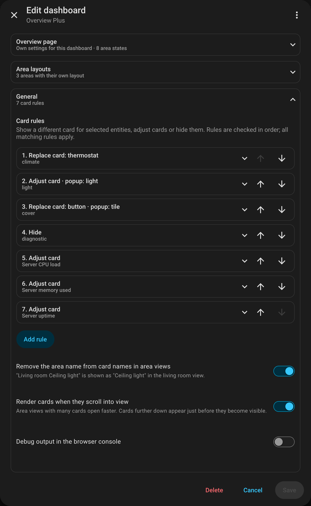

# Editor

[← Back to the overview](../README.md)

Everything is set up in the dashboard's editor: open the dashboard → ✏️ (edit). It has three collapsible
parts – *Overview page*, *Area layouts* and *General*. Each part shows a short summary in its header.

<table>
<tr>
<td width="50%"></td>
<td width="50%"></td>
</tr>
</table>

- Integration, domain, device class, manufacturer and model are dropdowns filled from your own
  installation; own values can be typed.
- Lists are ordered with the ↑/↓ buttons; list entries with a switch can be hidden.
- The form covers everything except the options specific to a replacement or popup card (every card type
  has different ones) and own area states. A selection, entity filter or primary entity the form cannot
  show (e.g. an either/or list) appears as YAML in its place. The few options that exist only in YAML are
  in the YAML blocks below.
- The editor's ⋮ menu switches to the YAML of the whole dashboard; each part below shows its YAML.
  Do not click **Take control** there: it turns the dashboard into a static copy that Overview Plus no
  longer updates.

Contents: [Overview page](#overview-page) · [Summaries and shortcuts](#summaries-and-shortcuts) ·
[Area states](#area-states) · [Area layouts](#area-layouts) · [Sections](#sections) ·
[Tile on the overview page](#tile-on-the-overview-page) · [Card rules](#card-rules) · [Options](#options) ·
[Selection criteria](#selection-criteria)

## Overview page

What it shows: [Overview page](overview-page.md).

- **Settings:** *Same as the built-in Overview* – favorites, summaries and so on come from the built-in
  Overview and are changed there (open it and click the pencil). *Own settings for this dashboard* gives
  this dashboard its own; switching copies the current ones of the built-in Overview as a starting point,
  *Copy from the built-in Overview* does it again later.
- With own settings: **Welcome message**, **Favorite entities**, **Suggested entities** and **Alert
  entities** (shown as an alert at the top of the page while active).

<table>
<tr>
<td width="50%"></td>
<td width="50%"></td>
</tr>
</table>

<details>
<summary>YAML</summary>

```yaml
strategy:
  type: custom:overview-plus
  load_home_settings: false            # own settings; default true = those of the built-in Overview
  favorite_entities: [light.living_room, climate.bathroom]
  hide_welcome_message: true
  hide_suggested_entities: true
  alert_entities:
    - { entity: binary_sensor.front_door, severity: alert }   # YAML only: severity alert | warning
```

With `load_home_settings: true` these options are ignored.

</details>

## Summaries and shortcuts

*Overview page → Summaries and shortcuts*:

- Order of the summaries, and which are shown.
- Expand a summary to choose the **page** it leads to; empty is Home Assistant's own page (media players:
  the media players view of Overview Plus). The category headings of the area views lead there too.
- **Add shortcut:** a tile leading to any page, with navigation path, label, icon and color.

With *Same as the built-in Overview*, order and visibility come from the built-in Overview; the part is
then called *Pages of the summaries* and only offers the pages.

<table>
<tr>
<td width="50%"></td>
<td width="50%"></td>
</tr>
</table>

<details>
<summary>YAML</summary>

```yaml
  shortcuts:                           # summaries in this order; missing ones are appended
    - { type: summary, key: climate }
    - { type: summary, key: security, hidden: true }
    - { type: custom, path: /map, label: Map, icon: mdi:map }
  summary_pages:
    light: /lights-plus/0              # any navigation path
    security: /alarm-panel/0
```

- Summary keys: `light`, `climate`, `security`, `media_players`, `maintenance`, `weather`, `energy`.
  `shortcuts` is ignored with `load_home_settings: true`.
- `summary_pages` keys: `light`, `climate`, `security`, `media_players`, `maintenance`, `energy`.

</details>

## Area states

What they show: [Area states](area-states.md). *Overview page → Area states*:

- Switch the states you want on; the order is the importance.
- Expand a state to choose **Show as** (*Tinted tile* or *Chip above the room icon*), **Icon** and **Color**.
- Own states are set in YAML; the editor then lists them with the others, so they can be moved or
  deleted there.

<table>
<tr>
<td width="50%"></td>
<td width="50%"></td>
</tr>
</table>

<details>
<summary>YAML</summary>

```yaml
  area_indicators:                     # switched-on states; order = importance
    - preset: occupied
    - preset: heating
    - preset: window_open
      color: red                       # override icon, color or style (tile | icon)
    - preset: occupied
      entity: binary_sensor.office_presence   # YAML only: these entities instead of searching the area
    - name: Washing                    # own state
      entity: sensor.washing_machine
      state: running                   # default on; several: [heat, boost]
      icon: mdi:washing-machine
      color: blue                      # shown as a chip unless style: tile
```

- Presets: `occupied`, `problem`, `heating`, `cooling`, `humidifying`, `drying`, `window_open`,
  `unlocked`, `lights_on`, `media_playing`, `fan_on`, `cleaning`.
- Own states: `attribute:` compares an attribute instead of the state; instead of `entity:`,
  `domain:` (and `device_classes:`) searches the area like a preset.

</details>

## Area layouts

What they do: [Area layouts](area-layouts.md). *Area layouts → Add area* gives an area its own layout;
*Remove area layout* returns it to the default view. Each area is a block with:

- **Badges:** *Default* (temperature and humidity), *None* or *Selected entities*.
- **Show the default sections:** lights, climate, security, media players and scenes as in the built-in
  Overview; they then appear in the list of sections, where they can be moved or hidden.
- **Show remaining devices** and **Show automations**.
- **[Tile on the overview page](#tile-on-the-overview-page)**.
- The **[sections](#sections)** and *Add section*.

<table>
<tr>
<td width="50%"></td>
<td width="50%"></td>
</tr>
</table>

<details>
<summary>YAML</summary>

```yaml
  area_overrides:
    living_room:                       # area id
      badges: [sensor.living_room_temperature]   # false = none; not set = default
      show_default_sections: true      # default false
      show_other_devices: true         # default
      show_automations: true           # default
      sections:
        - default: light               # a default section at this place (light, climate,
        - title: Power plugs           #   security, media_players, scenes); unnamed ones come first
          icon: mdi:power-socket-eu
          match: { label: power_plug }
        - default: scenes
          hidden: true                 # any section, own or default, can be hidden
```

</details>

## Sections

Expand a section in *Area layouts*:

- **Title**, **Icon** and **Layout**: *Tiles (one per entity)*, *Grouped by device*, *Compact (one tile per
  device)* or *Table (one list per device)* ([what they look like](area-layouts.md#layouts)).
- **Label:** devices or entities with one of these labels.
- **Refine selection:** more [selection criteria](#selection-criteria) – integration, domain, device class,
  entity category, manufacturer, model, device name, devices, entities – and under *Exclude* the same to
  leave out.
- **Entity filter:** *Only these domains*, *Not these domains*, *Entity categories shown* (empty: regular
  and diagnostic), *Not these device classes*, *Not these entities*.
- **Primary entity** (*Compact* only): domain and device class of the entity a device's tile shows;
  empty: chosen automatically.
- **Hide while in state:** conditions of domains (empty: all), device classes (optional) and the states
  that hide a card, e.g. `binary_sensor`, `occupancy`, `off`. The state is the one Home Assistant stores
  (`off`), not the translated text (*Clear*).
- **Order:** groups of domains and (optional) device classes, in the order the entities are shown.

<table>
<tr>
<td width="50%"></td>
<td width="50%"></td>
</tr>
</table>

<details>
<summary>YAML</summary>

```yaml
        - title: VMs & containers
          icon: mdi:cube-outline
          layout: compact                # tiles (default) | devices | compact | table
          match: { label: virt-guest, not: { entity_category: diagnostic } }
          primary: { domain: binary_sensor, device_class: running }
          entities:
            include_domains: [sensor, binary_sensor]
            exclude_domains: [button]
            include_categories: [none, diagnostic]   # default
            exclude_device_classes: [timestamp]
            exclude: [sensor.vm_backup_uptime]
            hide_states:
              - { domain: binary_sensor, device_class: occupancy, states: [off] }
              - { domain: media_player, states: [off, standby] }
          sort:
            - { domain: binary_sensor, device_class: occupancy }
            - { domain: [switch, light] }
            - sensor                     # a plain string is a domain
```

`match` and `primary` use the [selection criteria](#selection-criteria). `hide_states` can also be a plain
list of states for every entity of the section. Without `show_default_sections`, `default` entries are
ignored.

</details>

## Tile on the overview page

*Area layouts → (area) → Tile on the overview page*:

- **Name**, **Color**.
- **Values shown:** *Default* (the temperature, if the area has one), *Selected sensor classes* (the area's
  sensors of these device classes, combined into one value each) or *Selected entities* (their states
  in this order, also diagnostic sensors), optionally with **Show entity names**.
- **Alert icons:** an icon while a binary sensor of the area with one of these device classes is on.
- **Alert entities:** an icon while one of these binary sensors is on.

<table>
<tr>
<td width="50%"></td>
<td width="50%"></td>
</tr>
</table>

<details>
<summary>YAML</summary>

```yaml
    server:
      tile:
        color: blue
        entities: [sensor.server_cpu_load, sensor.server_memory_used]   # or sensor_classes: [temperature]
        show_names: true               # "CPU 12 % · RAM 41 %"
        alert_classes: [problem]
        alert_entities: [binary_sensor.server_problem]
```

Any option of the area card can be used too (YAML only). A tile with `display_type: picture` / `camera`
or `features` stays an area card – without area states.

An area can have a `tile` without `sections` – its area view then stays the default.

</details>

## Card rules

What they do: [Card rules](card-rules.md). *General → Card rules → Add rule*; rules are ordered with ↑/↓
and checked in this order. A rule has:

- **Action:** *Replace card*, *Adjust card* or *Hide*.
- **Card**, **Name**, **Icon**, **Color**; *More card options* (YAML) for the options of the chosen card,
  with the placeholders `$entity`, `$device`, `$area`, `$entities`.
- **On tap:** *Default (info dialog)* or *Card in a popup* – then **Popup card** and its options (YAML).
- **Applies to:** label and the other [selection criteria](#selection-criteria), also areas and floors;
  empty: all entities.
- **Where and how:** **Cards** – *One card per entity* or *One card per device*; **Only in** – favorites on
  the overview page, highlighted sections of area views, remaining devices of area views, media players
  view, devices view (empty: everywhere); **Stop here** – later rules are not applied to entities matched
  by this rule.

<table>
<tr>
<td width="50%"></td>
<td width="50%"></td>
</tr>
</table>

<details>
<summary>YAML</summary>

```yaml
  card_rules:
    - match: { integration: better_thermostat, domain: climate }    # Replace card
      card: { type: custom:better-thermostat-ui-card }
    - match: { entity: climate.bathroom }                            # Adjust card (no type)
      card: { name: Bathroom }
    - match: { label: dashboard-hidden }                             # Hide
      card: false
    - match: { label: virt-guest }                                   # One card per device
      scope: device
      card: { type: entities, title: $device, entities: $entities }
    - match: { domain: cover }                                       # Card in a popup
      contexts: [favorites, area]                                    # Only in
      tap:
        popup:
          type: tile
          features: [{ type: cover-open-close }, { type: cover-position }]
      stop: true                                                     # Stop here
```

- `contexts`: `favorites` (also suggested entities), `area`, `area_other`, `media`, `devices`.
- `entity` is set automatically unless the card uses `$entity`; `$entities` is the list of entity ids of
  a device (`scope: device`). The same holds for the popup card.
- `tap: false` (YAML only) removes a popup of an earlier rule.

</details>

## Options

*General*, below the card rules:

<table>
<tr>
<td width="50%"></td>
<td width="50%"></td>
</tr>
</table>

| Editor | YAML | Default |
|---|---|---|
| Remove the area name from card names in area views | `strip_area_names` | `true` |
| Render cards when they scroll into view | `lazy_render` | `true` |
| Debug output in the browser console | `debug` | `false` |

- `strip_area_names`: "Living room Ceiling light" → "Ceiling light", in card names and device headings of
  area views and the media players view.
- `lazy_render`: cards below the first screen of a view are rendered just before they become visible.
- `debug`: logs the generated views (and the section assignment of area views).

## Selection criteria

*Label*, *Refine selection* and *Applies to* select entities by these criteria. In YAML they form a `match`:
all criteria in one object must match (AND), a list of objects matches if any object matches (OR). Such
a list, or a criterion without a field, is shown as YAML in the editor. Every criterion takes one value or
a list.

| Editor | YAML | Matches |
|---|---|---|
| Label | `label` | label id on the entity **or** its device (YAML only: `entity_label` / `device_label`) |
| Integration | `integration` | integration of the entity, e.g. `better_thermostat`, `mqtt` |
| Domain | `domain` | e.g. `climate`, `sensor` |
| Device class | `device_class` | `none` if unset |
| Entity category | `entity_category` | `none`, `config`, `diagnostic` |
| Manufacturer / Model | `manufacturer` / `model` | picked from the list: exact; own text: part of the name (regular expression); ignoring case |
| Device name contains | `device_name` | regular expression, ignoring case, e.g. `^pve` |
| Devices / Entities | `device` / `entity` | device ids / entity ids |
| Areas / Floors | `area` / `floor` | area ids / floor ids |
| Exclude | `not` | the same criteria, must not match, e.g. `not: { entity_category: diagnostic }` |

For devices that arrive through the same integration (e.g. several MQTT bridges), **labels** are the most
robust way to group them – assign them in Home Assistant, no dashboard change needed.
