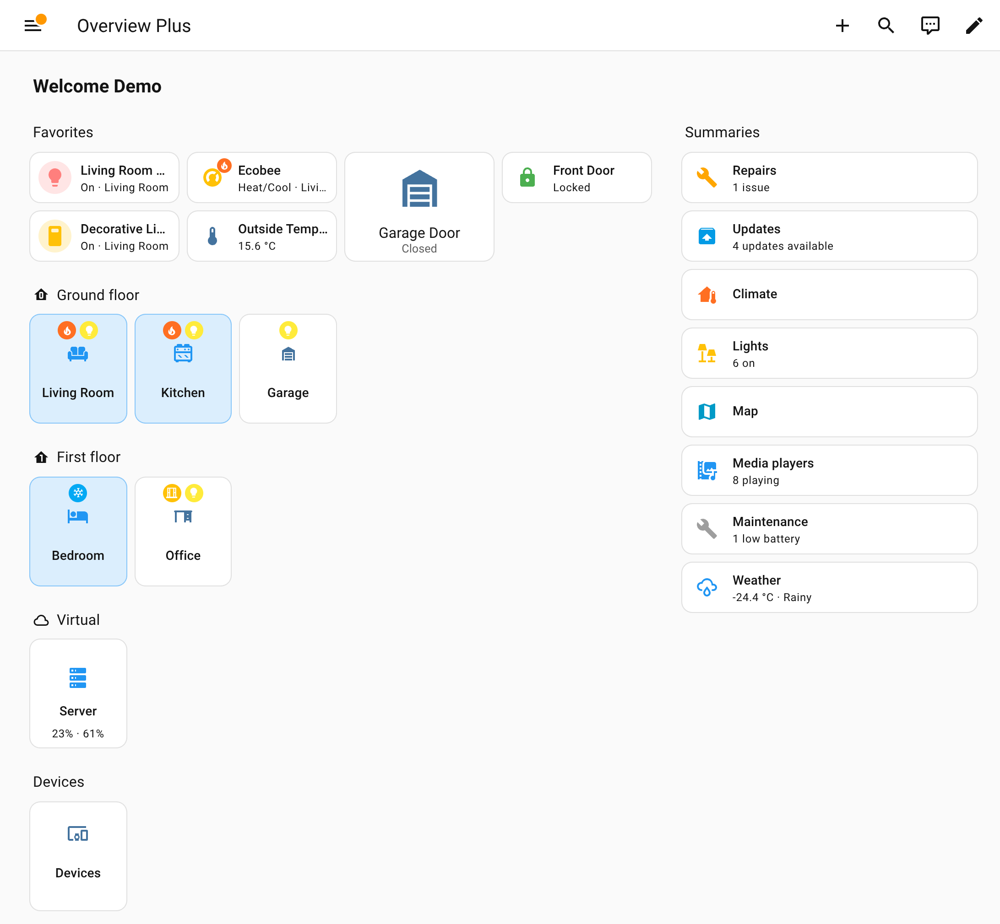
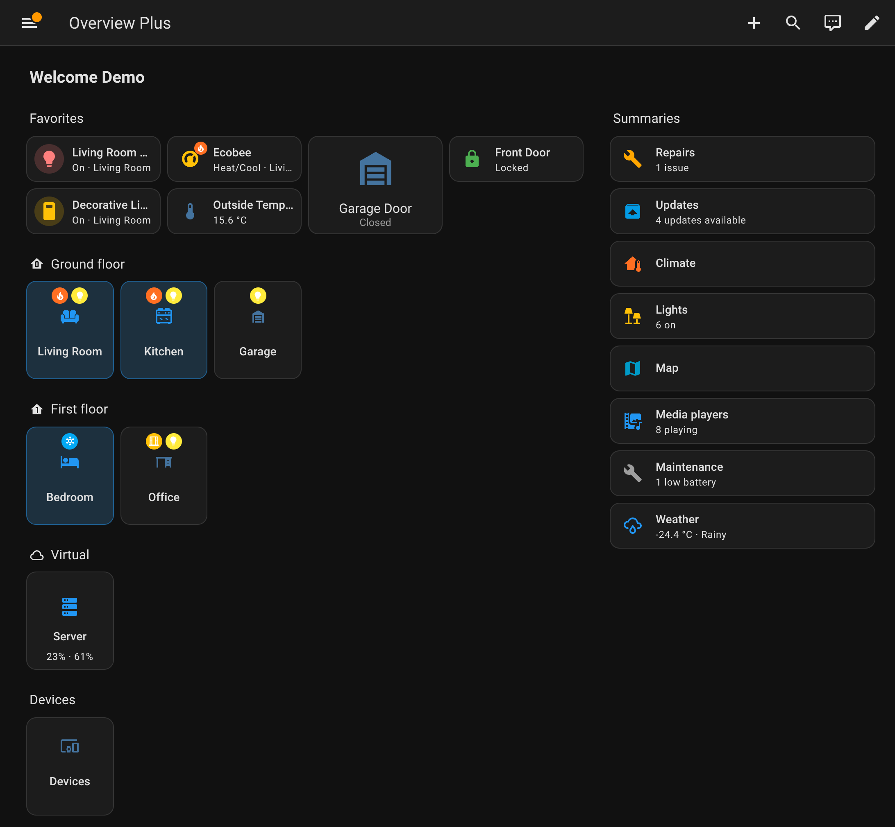
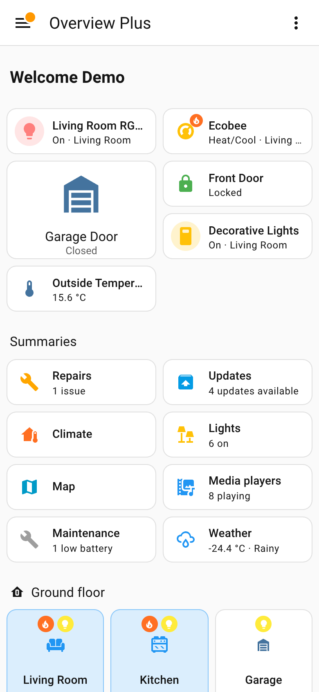
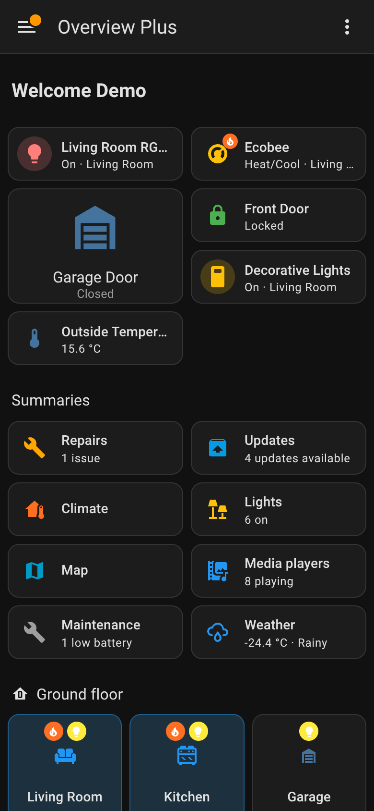
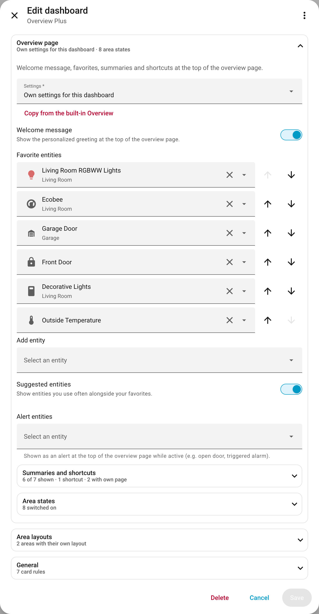
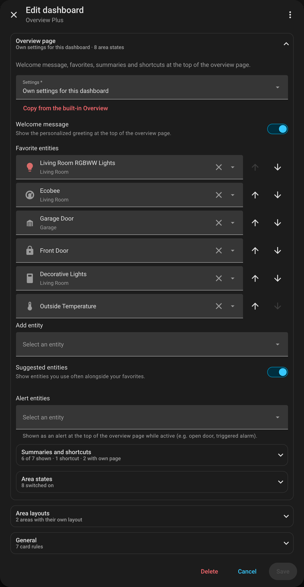
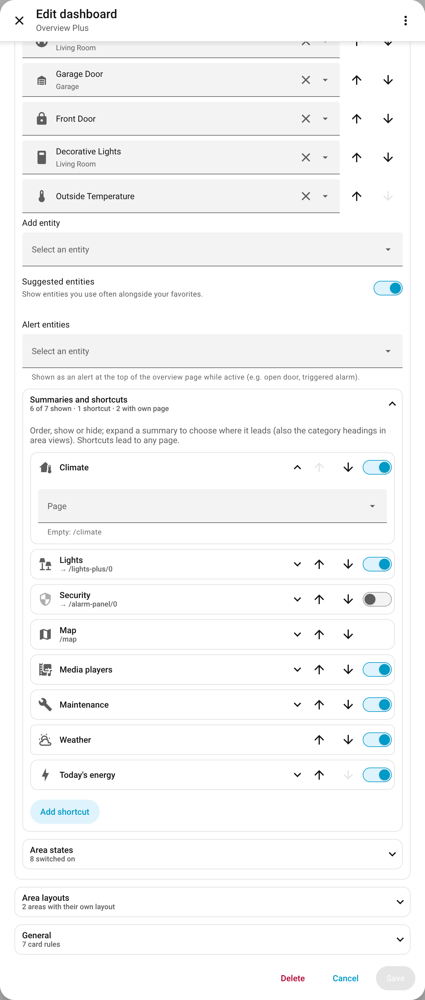
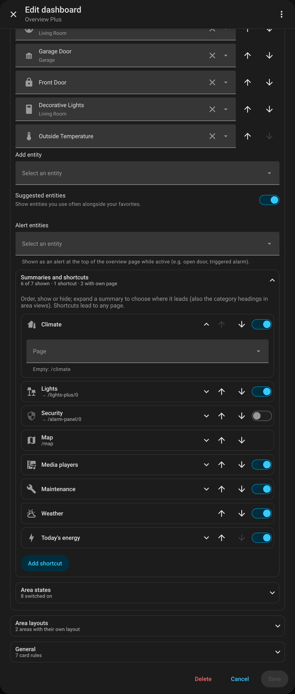

# Overview page

[← Back to the overview](../README.md)

The first page of the dashboard: welcome message, favorites and suggested entities, then one tile per
area, grouped by floor; on the right the summaries (repairs, updates, lights, media players,
maintenance, weather …) and shortcuts. The screenshots show the Home Assistant demo integration: occupied
rooms are tinted, chips show heating, lights and an open window ([area states](area-states.md)); the
*Server* tile shows CPU and memory instead of the temperature ([tile](area-layouts.md#tile-on-the-overview-page)).

<table>
<tr>
<td width="50%"></td>
<td width="50%"></td>
</tr>
<tr>
<td width="50%"></td>
<td width="50%"></td>
</tr>
</table>

## Own settings or those of the built-in Overview

Welcome message, favorites, suggested entities, summaries and shortcuts, and alert entities are by
default the same as in the built-in Overview (*Edit Overview page* there). In the editor,
*Overview page → Settings → Own settings for this dashboard* gives the dashboard its own; switching copies the
current settings of the built-in Overview as a starting point, *Copy from the built-in Overview* does it
again later.

```yaml
strategy:
  type: custom:overview-plus
  load_home_settings: false            # own settings instead of those of the built-in Overview
  favorite_entities: [light.living_room, climate.bathroom]
  hide_welcome_message: true
  hide_suggested_entities: true
  shortcuts:                           # summaries in this order; missing ones are appended
    - { type: summary, key: climate }
    - { type: summary, key: security, hidden: true }
    - { type: custom, path: /map, label: Map, icon: mdi:map }
  alert_entities:
    - { entity: binary_sensor.front_door, severity: alert }   # severity: alert | warning
```

Summary keys: `light`, `climate`, `security`, `media_players`, `maintenance`, `weather`, `energy`.
With the built-in settings (`load_home_settings: true`, the default), these options are ignored.

<details>
<summary>Screenshot: the overview page in the editor</summary>

<table>
<tr>
<td width="50%"></td>
<td width="50%"></td>
</tr>
</table>

</details>

## Pages of the summaries

The summaries on the overview page and the category headings of an area view (*Lights*, *Climate*,
*Security*, *Media players*) lead to Home Assistant's own pages – or to a dashboard of your own:

```yaml
strategy:
  type: custom:overview-plus
  summary_pages:
    light: /lights-plus/overview       # any navigation path
    security: /dashboard-alarm/0
```

Keys: `light`, `climate`, `security`, `media_players`, `maintenance`, `energy`. Not set: Home
Assistant's page (`/light`, `/climate`, …; media players: the media players view of Overview Plus).
In the editor: *Overview page → Summaries and shortcuts* – expand a summary to choose its page (with
the built-in settings, the list shows only the pages).

<details>
<summary>Screenshot: summaries and shortcuts in the editor</summary>

<table>
<tr>
<td width="50%"></td>
<td width="50%"></td>
</tr>
</table>

</details>
